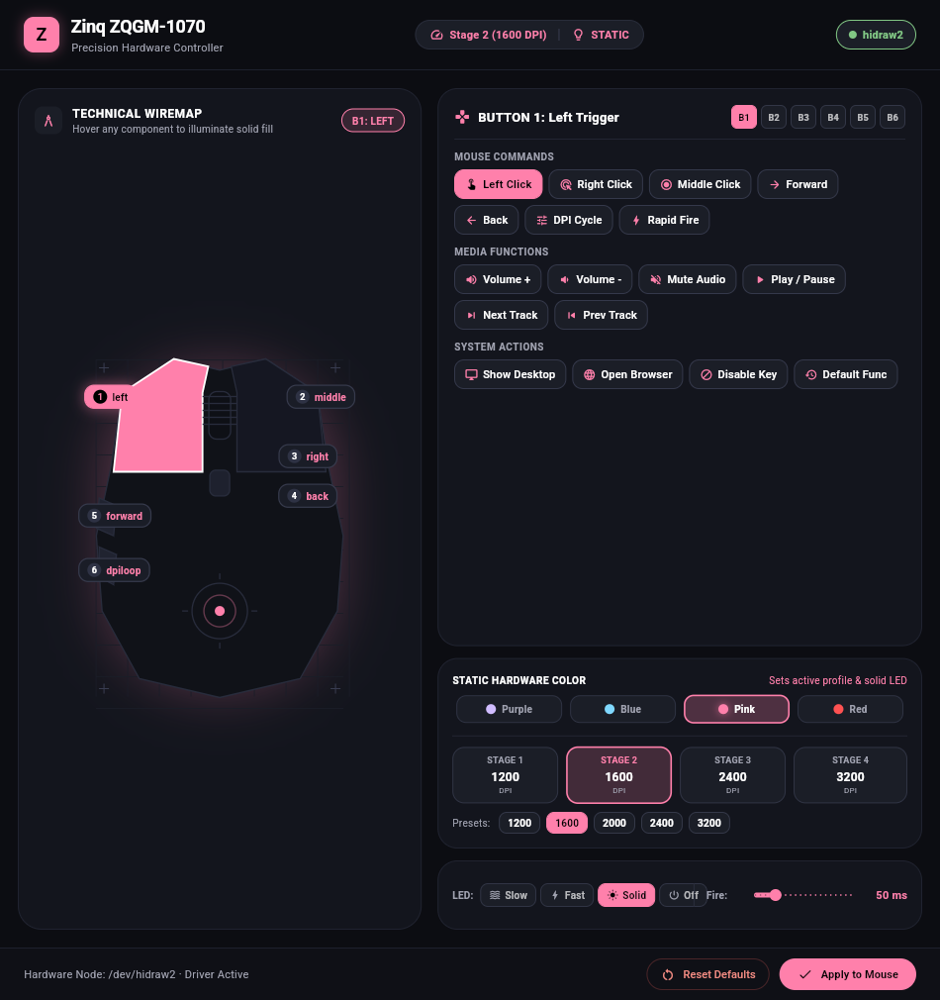
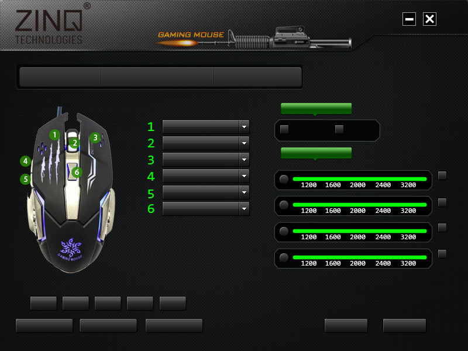

# Zinq ZQGM-1070 Gaming Mouse Controller for Linux

Native Linux utility and graphical configuration tool for the **Zinq Technologies ZQGM-1070 LED Backlight Gaming Mouse** (USB VID: `0x18f8`, PID: `0x0f99`, OEM: Instant Technology / Maxxter).

Reverse-engineered directly from the official Windows installer (`ZQGM-1070 Gaming Mouse Programe.exe`) using Ghidra and REA analysis.

---

## Features

- **Lighting Effects (LED Mode)**:
  - Breathing Slow (`slow`)
  - Breathing Fast (`fast`)
  - Static Constant On (`static`)
  - LED Off (`off`)
- **DPI Resolution Stages**:
  - 1200, 1600, 2000, 2400, and 3200 DPI
  - 4 independent stages with live switching
- **Button Mapping (Buttons 1–6)**:
  - Left, Middle, Right, Back, Forward, DPI Loop
  - Media keys: Volume Up, Volume Down, Play/Pause, Next Track, Previous Track, Mute
  - System functions: Show Desktop, Rapid Fire, Browser, Disabled
- **Rapid Fire Timing**: Configurable click interval (10 ms – 200 ms)
- **Factory Reset**: Restores hardware defaults
- **CLI & Modern GUI**: Full command line control plus a dark-themed Tkinter GUI

---

## Reverse Engineering & Protocol Breakdown

The Windows software `GamingMouse.exe` communicates with the mouse using **USB HID Feature Reports** on **Interface 1** (Usage Page `0xFF01`, Usage `0x01`):

- **Report ID**: `0x07`
- **Packet Size**: 8 bytes (`[0x07, Subcommand, Byte2, Byte3, 0x00, 0x00, 0x00, 0x00]`)

### Subcommands

| Subcommand | Function | Payload Structure |
|---|---|---|
| `0x09` | **DPI & LED Mode** | `byte[2]` = active stage index (`0..3`)<br>`byte[3]` = `((dpi_code + 8) << 4) \| led_mode` |
| `0x10` | **Button Mapping** | `byte[2]` = button number (`1..6`)<br>`byte[3]` = action code |
| `0x11` | **DPI Mask** | `byte[2]` = stage enable mask (`0x00` = all enabled) |
| `0x12` | **Fire Interval** | `byte[2]` = `fire_interval_ms >> 3` |
| `0x20` | **Factory Reset** | Resets mouse hardware to default firmware state |

#### DPI Encoding Table (`dpi_code`):
- `1` = 1200 DPI
- `2` = 1600 DPI
- `3` = 2000 DPI
- `4` = 2400 DPI
- `0` = 3200 DPI

#### LED Mode Encoding (`led_mode`):
- `0` = Breathing Slow
- `1` = Breathing Fast
- `2` = Static Solid On
- `3` = Off

---

## Non-Root Permissions (udev Rule)

To allow the user to control the mouse without requiring `sudo` or `root`:

Installed at `/etc/udev/rules.d/99-zinq-mouse.rules`:
```udev
KERNEL=="hidraw*", SUBSYSTEM=="hidraw", ATTRS{idVendor}=="18f8", ATTRS{idProduct}=="0f99", MODE="0666", TAG+="uaccess"
```

---

## Usage

### 1. Command Line Interface (`zinq-mouse`)

```bash
# Check device status and current mappings
zinq-mouse status

# Change LED lighting mode
zinq-mouse led slow
zinq-mouse led fast
zinq-mouse led static
zinq-mouse led off

# Change DPI
zinq-mouse dpi 1600
zinq-mouse dpi 3200 --stage 4

# Switch active DPI stage
zinq-mouse stage 2

# Remap mouse buttons (1 to 6)
zinq-mouse button 4 volup
zinq-mouse button 5 voldown
zinq-mouse button 6 dpiloop

# Set rapid fire speed (in milliseconds)
zinq-mouse fire 40

# Factory reset
zinq-mouse reset
```

## Graphical User Interface (GUI)

The application provides a native, hardware-accelerated **Flutter Desktop (Dart 3)** graphical interface designed with Google's **Material 3 Expressive (Android 15 / Pixel)** design language (inspired by [`sameerasw/essentials`](https://github.com/sameerasw/essentials)):

- **Expressive Group Cards**: High-radius (24px) rounded containers with Google Pixel tonal surface hierarchy (`#121318` -> `#1E2028` -> `#262834`).
- **Interactive Lighting Pills**: Large pill chips with Material icons for immediate switching between Slow Breathing, Fast Breathing, Static Solid, and Off.
- **Stage Sensitivity Grid**: 4 stage profile cards with active status pills and quick preset chips (1200, 1600, 2000, 2400, 3200 DPI).
- **Preference List Tiles**: Android Settings-style preference cards with rounded icon avatars and dropdown selectors for all 6 mouse buttons.
- **Hardware Burst Timing**: Continuous slider with real-time millisecond badge for rapid fire configuration.
- **Hardware Action Buttons**: Prominent M3 FilledButton (`Apply to Mouse`) and confirmation dialog for factory reset.



### OEM Windows Driver Reference
Extracted directly from the original `GamingMouse.exe` installer skins:


